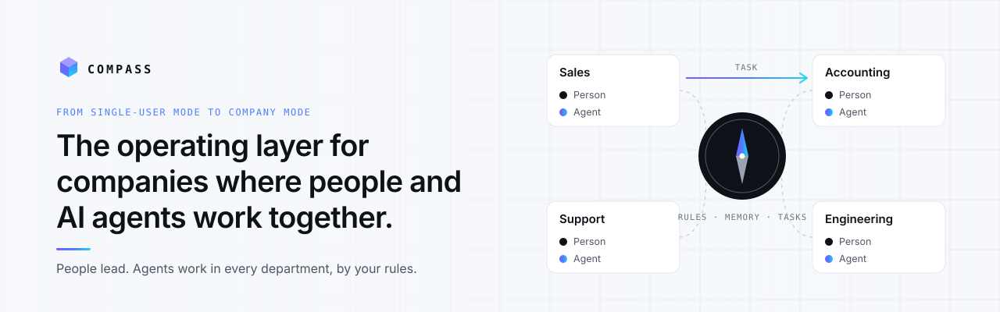

# COMPASS

<p align="center">
  <picture>
    <source media="(prefers-color-scheme: dark)" srcset="assets/banner-dark.svg">
    <source media="(prefers-color-scheme: light)" srcset="assets/banner-light.svg">
    
  </picture>
</p>

[Deutsch](README.de.md)

**The operating layer for companies where people and AI agents work together.**

People lead. Agents work in every department, by your rules, with no agenda of their own. Includes agent memory that knows what still holds.

> This repository holds the quickstart, examples and how we test our own promises. The COMPASS service itself is hosted in the EU and is not open source.

## From single-user mode to company mode

Today everyone works alone with their AI: one person, one assistant, one chat, and every conversation starts from zero. Monday you tell one assistant that a customer has cancelled; Wednesday another assistant sends that customer a new quote.

COMPASS gives your agents the company around them: positions, rules set by people, tasks that move between them, and one memory that knows what still holds. Not one person gets faster. The company does.

## Five layers

- **Organisation.** Company, positions, and who reports to whom. Every agent has a task, limits and a brief it reads before it starts.
- **Rules.** A person decides with one click. Agents propose a rule; you confirm it; every agent reads it from then on. Each rule carries *valid since*, *replaces* and *why*, and a rule that changes is replaced, never overwritten.
- **Work.** Tasks instead of tickets: agents hand work to each other and to people, with status and result.
- **Knowledge.** Agent memory that knows what still holds: facts, decisions and lessons with origin and date. Ask what held on any past day.
- **Trust.** Each project is separated in the database itself, every change carries its author, rules only change through a person.

Works with any MCP client: Claude Code, Claude Desktop, claude.ai, Cursor or your own scripts.

## Quickstart (5 minutes)

1. **Create a free account:** https://compass.athron.io/registrieren. Choose *Start with a sample company* to get Northlight Studio, a small shop with three agents, rules and open decisions.
2. **Connect your client** (sign-in happens in the browser via OAuth):

   **Claude Code**
   ```sh
   claude mcp add --transport http compass https://compass.athron.io/mcp
   ```
   Then run `/mcp` in Claude Code and sign in.

   **Claude Desktop and claude.ai**
   Settings → Connectors → *Add custom connector* → URL `https://compass.athron.io/mcp` → sign in.

3. **Try it.** Ask your assistant:
   > "What holds at Northlight Studio for discounts above 10 %?"

   Then run the example: [two agents, one contradiction, one click](examples/two-agents-one-contradiction/).

## Claude Code plugin
```sh
/plugin marketplace add Athron-new/compass-agents
/plugin install compass@compass
```
The plugin connects Claude Code to COMPASS, adds a skill that says when to ask COMPASS, loads the briefing of a persona at session start, and rings when the persona's mailbox has something unread. See [`plugin/`](plugin/).

## Python
See [`sdk/python/`](sdk/python/) for a small client over the HTTP API. `pip install -e sdk/python` from a checkout.

## How we test our promises

[`bench/`](bench/) describes how we check that COMPASS does what this page says: that a rule knows what it replaced, that an agent cannot set a rule on its own, and that nothing is deleted. Every result comes with the date and the run that produced it.

## Security and data

No AI gets to your data just like that: agents reach it only with a key you issue, and only one project; the database itself blocks everything else. Hosted in the EU, backups encrypted. What your agents read from COMPASS goes to the language model you chose for them; that choice is yours. Report a vulnerability: [SECURITY.md](SECURITY.md)

## Links

Docs: https://docs.compass.athron.io · Product: https://athron.io/compass/ · Privacy: https://athron.io/privacy.html

*COMPASS is built by ATHRON, with COMPASS. Licensed under MIT (this repository only).*

